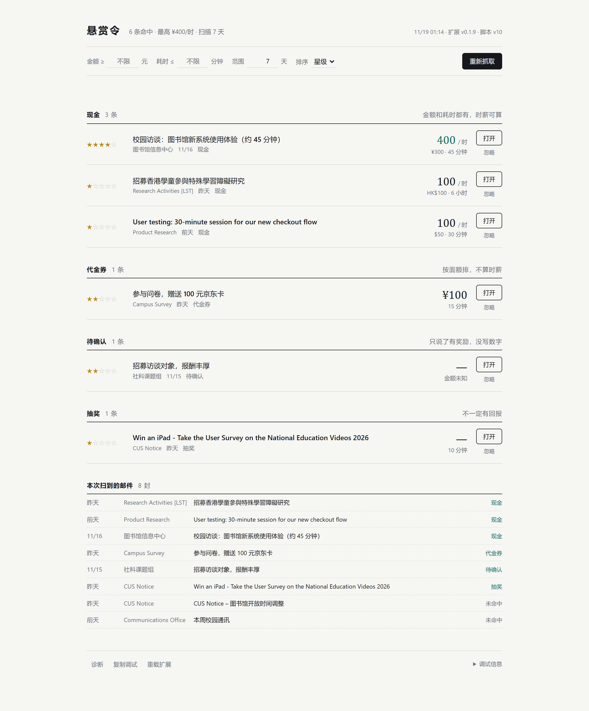

# 悬赏令 · Outlook 有偿招募清单

从学校/公司的 Outlook 网页里，把「给钱、给券」的研究招募邮件挑出来，按 **时薪 × 形式** 打 1–5 星，
渲染成一张费率清单。点一条就能直接跳到那封原始邮件。



## 它解决什么

学校邮箱里混着大量「参与研究得 HKD100」「填问卷送礼品卡」「赢 iPad」的邮件。
一条条翻很费劲，而且真正的问题是：**这活儿值不值得花那 45 分钟**。

所以清单把「时薪」当主数字：金额 ÷ 耗时，高的在上；算不出时薪的（代金券、抽奖、只说“报酬丰厚”）
单独分区，不冒充收入。

## 安装（Chromium 内核，Chrome / Edge）

1. 打开 `chrome://extensions`，开启「开发者模式」
2. 「加载已解压的扩展程序」→ 选本仓库的 `extension/` 目录
3. 在浏览器里登录 Outlook 网页版，进收件箱
4. 打开 `chrome-extension://<扩展ID>/board.html` → 点「重新抓取」

## 它怎么工作

- **采集**：读列表行的可见文字（`[role="listbox"] [role="group"]`），不读正文
- **翻页**：这一版 Outlook 是虚拟列表，`scrollTop` 和合成事件都无效，
  所以用 `chrome.debugger` 发**可信滚轮**逐屏推进（扫描时 Chrome 顶部会出现调试提示，属正常）
- **解析**：正则抽金额与耗时；`parser.js` 是纯函数，配 29 项测试
- **跳转**：行 id 在祖先元素的 `data-convid` 上，深链 `…/mail/inbox/id/<id>` 可直接打开；
  找不到时退回“滚到那一行再点”
- **补全**：打开某封邮件后，从正文补回缺失的耗时/金额并写回数据

## 已知限制

- 只支持这一版 Outlook 网页（`outlook.cloud.microsoft`）。改版后选择器可能失效，
  排障笔记见 [docs/owa-dom.md](docs/owa-dom.md)
- 需要 `chrome.debugger` 权限；扫描期间浏览器顶部会有调试提示
- 未打包扩展改动后**必须重载**（`chrome://extensions` 里点 ⟳）。Chrome 不会自动重读磁盘
- 列表按「重点/其他」分组时，只会看到当前分组

## 开发

```
node tools/build.mjs        # src/ → extension/content.js（合并产物）+ dist/firefox
node test/parser.test.mjs   # 29 项解析测试
```

**不要直接改 `extension/content.js`**，它是 `src/parser.js` + `src/content.core.js` 的合并产物。

## 目录

```
extension/      可加载的扩展（含构建产物 content.js）
src/            源码：parser.js（纯函数）、content.core.js（DOM 采集）
tools/build.mjs 构建
test/           解析回归测试
docs/           Outlook DOM 实测笔记 + 截图
skills/         DSH 技能封装（可选）
```

## 许可

MIT
