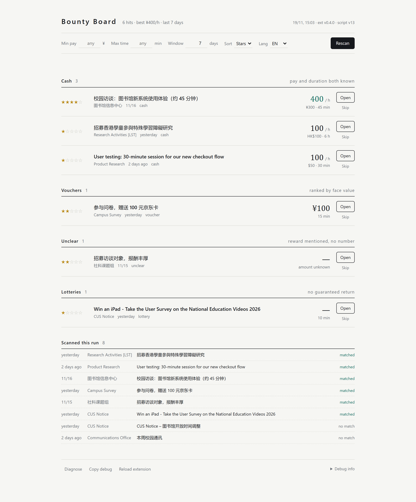

# Bounty Board

A browser extension that turns a university Outlook inbox into a ranked list of paid research studies — sorted by how much they actually pay per hour.



The interface ships in English and Chinese; the toggle in the toolbar switches language and the choice is remembered. ([中文界面](docs/shots/board-zh-desktop.png))

## Why

A student inbox is full of "join our study for HKD 100", "fill this survey for a gift card", "win an iPad".
Reading them one by one is slow, and the real question is never "is there a reward?" — it's **"is this worth 45 minutes of my afternoon?"**

So the board leads with an hourly rate: money ÷ time. Anything that can't be priced honestly — vouchers, lotteries, "generous compensation" — gets its own group instead of pretending to be income.

## Install

Chromium browsers only (Chrome, Edge).

1. Open `chrome://extensions` and turn on **Developer mode**
2. **Load unpacked** → pick the `extension/` folder in this repo
3. Sign in to Outlook on the web and open your inbox
4. Visit `chrome-extension://<extension-id>/board.html` and hit **Rescan**

## How it works

- **Collection** reads the visible text of each mail row (`[role="listbox"] [role="group"]`). Subjects, senders, previews, timestamps.
- **Paging** is the hard part: this Outlook build renders a virtualized list where `scrollTop` does nothing and synthetic `WheelEvent`s are ignored. The extension attaches `chrome.debugger` and sends real wheel input, a screen at a time. Chrome shows its debugging banner while this runs, and the extension detaches when done.
- **Parsing** pulls money and duration out of the row text with a small set of regexes in `parser.js` — a pure module with 28 regression tests.
- **Opening** uses the row's `data-convid` to build `…/mail/inbox/id/<id>`, which loads that exact message. When a row has no id, the extension scrolls until it finds the row and clicks it instead.
- **Language** is a two-entry dictionary in `board.js` (`I18N.en` / `I18N.zh`). Adding a language means adding one object and one `<option>`.

## Limits

- Built against one Outlook build (`outlook.cloud.microsoft`). If Microsoft ships a new DOM, selectors break — see [docs/owa-dom.md](docs/owa-dom.md) for what was measured and how to re-derive it.
- Requires the `chrome.debugger` permission. That makes it effectively unpublishable on the Chrome Web Store; load it unpacked or ship it yourself.
- Unpacked extensions don't reload themselves. After changing code you must click ⟳ on `chrome://extensions`.
- Only the current mail group (Focused / Other) is visible at a time.

## Development

```
node tools/build.mjs        # src/ → extension/content.js (+ dist/firefox)
node test/parser.test.mjs   # 28 parsing tests
```

`extension/content.js` is generated — edit `src/parser.js` or `src/content.core.js` instead.

## Layout

```
extension/      loadable extension (content.js is built)
src/            parser.js (pure functions) + content.core.js (DOM collection)
tools/build.mjs
test/
docs/           measured Outlook DOM notes, screenshots
skills/         DSH skill wrapper (optional)
```

## License

MIT

---

## 中文说明

把学校 Outlook 网页里的「给钱、给券」招募邮件抓出来，按 **时薪** 排成一张清单：金额 ÷ 耗时，高的在上。
算不出时薪的（代金券、抽奖、只说“报酬丰厚”）单独分组，不冒充收入。

界面中英双语，工具栏的「语言」可切换，选择会记住。

**安装**：`chrome://extensions` → 开发者模式 → 加载已解压的扩展程序 → 选 `extension/` → 登录 Outlook 后打开
`chrome-extension://<扩展ID>/board.html` → 点「重新抓取」。

**两个必须知道的点**

1. 这一版 Outlook 是虚拟列表，`scrollTop` 和合成滚轮事件都无效，所以用 `chrome.debugger` 发真实滚轮翻页——扫描时浏览器顶部会出现调试提示，扫完自动断开。
2. 未打包扩展改动后必须手动重载（`chrome://extensions` 里点 ⟳），Chrome 不会自动重读磁盘。

**已知限制**：只针对 `outlook.cloud.microsoft` 这一版页面；改版后选择器会失效，排障笔记在 [docs/owa-dom.md](docs/owa-dom.md)；
`chrome.debugger` 权限导致它基本无法上架 Chrome 应用商店，只适合自己加载使用。

**开发**：`node tools/build.mjs` 构建，`node test/parser.test.mjs` 跑测试。别直接改 `extension/content.js`。
